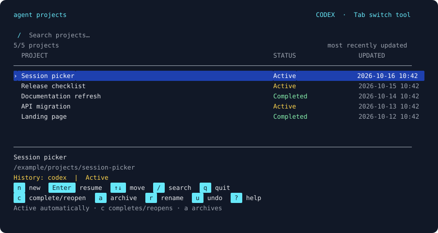

# Agent Projects

**Pick up your work with Codex, Claude Code, or GitHub Copilot CLI.**

A keyboard-first terminal picker for your local agent conversations. See what you
were working on, when you last touched it, and where you left off. Switch tools
without reconstructing project context from scratch.



Agent Projects discovers existing local conversations, resumes each tool's native
session, and maintains a shared Markdown handoff for each project. **It does not
convert chat histories between agents.** On the first switch, the receiving agent
is asked to read the handoff and relevant original local transcript messages.

## Install

Requires **Python 3.10+**, macOS or Linux, a UTF-8 terminal, and at least one
supported agent installed and authenticated separately. Windows is not supported
natively; use WSL. There are **no runtime Python dependencies**.

With [pipx](https://pipx.pypa.io/):

```sh
pipx install git+https://github.com/ssebro/agent-projects.git
agent-projects
```

Or install from a checkout in an isolated environment:

```sh
git clone https://github.com/ssebro/agent-projects.git
cd agent-projects
python3 -m venv .venv
.venv/bin/python -m pip install .
.venv/bin/agent-projects
```

The project is not published on PyPI. Installation does not modify your shell
configuration or replace any agent binary.

## Use it

```sh
agent-projects                    # Start the picker with Codex selected
agent-projects --agent claude     # Start with Claude Code selected
agent-projects --agent copilot    # Start with GitHub Copilot selected
agent-projects list               # Script-friendly tab-separated listing
agent-projects list --json        # Include IDs, directories, and native session links
agent-projects doctor             # Paths, discovery warnings, and available tools
```

| Key | Action |
| --- | --- |
| `n` | Start a new conversation immediately, in the current Terminal directory |
| `↑` / `↓` or `k` / `j` | Select a project |
| `Enter` | Resume the selected project with the selected tool |
| `Tab` | Cycle Codex → Claude Code → Copilot |
| `/` | Filter by project name, status, or directory |
| `r` | Rename the project in this picker |
| `s` | Ask the selected agent for a progress summary and suggested names |
| `c` | Toggle the project between Active and Completed |
| `a` | Archive the project from the shared list |
| `u` | Restore the last archived project, including after a restart |
| `q` | Quit |

Names come from the native session title or first prompt until you rename them.
Status tracks the lifecycle: **Active, Completed, or Archived**, not live running/idle activity. Dates are
local time and reflect the latest native session or shared-handoff modification.
Distinct tasks in the same directory remain separate projects. Rows are compact:
project name, status, then date. The full selected name and directory appear in
the preview. Narrow terminals shorten the date and keep one line per project.
Color distinguishes the selection, command keycaps, and lifecycle; text
labels and a selection marker also work in monochrome. Set `NO_COLOR=1` to opt out.

Discovered projects are Active automatically; there is no status field to fill
out. Press `c` when work is complete, and `c` again to reopen it. Resuming a project
marks it Active. New native session activity after completion also makes it Active
at the next discovery. Handoff edits alone do not reopen completed work.

**Archive is reversible:** it hides the project from all three pickers. Native
conversation history and shared notes stay on disk. `u` restores the most recently
archived project to its prior lifecycle, including across restarts. Archived
projects stay hidden even if their native session changes. Native deletion is left
to each tool. `agent-projects list --all` includes archived projects. The `forget`
CLI command and legacy `d`-then-`y` shortcut are aliases for archive.

### Agent-generated summaries and names

Press `s` on a project. The selected agent receives a bounded sample of recent
user/assistant messages and existing handoff notes, then suggests a short progress
summary, next steps, and up to three names. Tool output and hidden reasoning are
excluded from the sample. The result may be incomplete if important context is
outside that excerpt; the prompt asks the agent to state uncertainty.

After seeing the result, press Enter to save only the summary, select a suggested
name by number to save both, or `q` to discard. Names and summaries never change
without that choice; reviews do not change lifecycle. Saved summaries appear in
the preview and shared handoff. New native activity or handoff edits mark the
summary as potentially stale.

This is an explicit model request using your selected CLI's account, permissions,
and billing. It runs only when requested. Codex reviews use ephemeral read-only
sessions; Claude reviews disable tools and native persistence; Copilot reviews deny
tools and use separate session IDs excluded from this picker. No background
summarizer runs. Review-generation flags are checked against the documented native
CLIs; authenticated model inference is not part of the automated tests.

For scripts, `agent-projects --agent claude review ID --json` prints suggestions
without applying them. `list --json` includes previously saved summaries without
calling a model.

### Optional: show the picker when you start an agent

After making `agent-projects` available on PATH, add this line to `~/.zshrc` or
`~/.bashrc`:

```sh
eval "$(agent-projects shell-init)"
```

Open a new Terminal, or evaluate the same line in your current shell. These
small shell functions open the picker for bare `codex`, `claude`, `copilot`, or
`gh copilot`. Invocations with arguments, such as `codex --help`, `claude --resume
ID`, and `gh repo list`, pass through unchanged. Noninteractive invocations also
pass through. You can inspect the functions with `agent-projects shell-init`.

For Copilot, a standalone `copilot` binary is preferred. Otherwise the launcher
uses `gh copilot -- …`; current GitHub CLI versions may offer to install Copilot
on first use. This supports the current agentic Copilot CLI, not the retired
`gh-copilot` suggestion extension. It does not manage cloud or IDE-only sessions.

### Shared handoffs

Select a project and resume it, or create its handoff explicitly:

```sh
agent-projects list --json
agent-projects handoff 'codex:YOUR-SESSION-ID'
agent-projects set 'codex:YOUR-SESSION-ID' --name 'Release checklist' --status completed
agent-projects --agent claude resume 'codex:YOUR-SESSION-ID'
```

Use the actual ID from `list`; unique ID prefixes also work. A handoff contains
the goal, decisions, findings, changed files, validation, and next steps. You can
edit it yourself. A `Status: ...` line provides an optional progress note in the
preview; it does not control Active/Completed/Archived. Every resume
asks the agent to read and maintain the handoff. This is an instruction, not a
guarantee: check the notes when switching tools. Agent Projects does not run a
background model to summarize your work. New (`n`) starts a normal native
conversation; shared handoff instructions are added on its first picker resume.

The first resume in another tool creates its native conversation. Subsequent
launches resume that conversation through a stored link. Claude and Copilot use
explicit session IDs. New Codex sessions are linked after the process exits only
when exactly one newly discovered session matches the working directory. An
ambiguous match is left unlinked and reported. See [limitations](docs/compatibility.md).

## Local data and privacy

Native history is read in place. Agent Projects writes its own metadata and
handoffs under `${XDG_STATE_HOME:-~/.local/state}/agent-projects/`, outside the
source checkout. The launcher itself makes no network requests, reads no auth
tokens, and never changes native history or permission settings. Agent CLIs keep
their own normal authentication, network, permission, and billing behavior.

**When an agent reads a handoff or transcript, it may send that content to its
model provider under your existing settings.** Think about that boundary when
moving a project between work and personal accounts. Do not commit your runtime
data to this repository. See [privacy and security](SECURITY.md).

| Environment variable | Default | Purpose |
| --- | --- | --- |
| `AGENT_PROJECTS_HOME` | `$XDG_STATE_HOME/agent-projects` | Launcher metadata and handoffs |
| `XDG_STATE_HOME` | `~/.local/state` | Base directory for launcher data |
| `CODEX_HOME` | `~/.codex` | Codex history discovery |
| `CLAUDE_CONFIG_DIR` | `~/.claude` | Claude Code history discovery |
| `COPILOT_HOME` | `~/.copilot` | Copilot CLI history discovery |

`--data-dir PATH` overrides `AGENT_PROJECTS_HOME`. Agent-specific environment
variables are inherited by the launched tools. Separate work/personal histories
need separate agent configuration as well as separate launcher data directories.

## Uninstall

Remove the `shell-init` line from your shell configuration and open a new shell,
then run `pipx uninstall agent-projects` (or delete your dedicated virtual
environment). Your native sessions are unaffected. Launcher data is deliberately
retained; remove its data directory separately if you no longer want the notes.

## Development

```sh
python3 -m venv .venv
.venv/bin/python -m pip install -e '.[dev]'
.venv/bin/python -m unittest discover -s tests -v
.venv/bin/ruff check .
.venv/bin/python -m build
```

Tests can also run with no installed dependencies:

```sh
PYTHONPATH=src python3 -m unittest discover -s tests -v
```

See [CONTRIBUTING.md](CONTRIBUTING.md), the [architecture](docs/architecture.md),
and [compatibility notes](docs/compatibility.md). Contributions should use
synthetic session fixtures; never upload actual conversation history.

## License

[MIT](LICENSE). Independent community software; not affiliated with OpenAI,
Anthropic, or GitHub. Product names belong to their respective owners.
