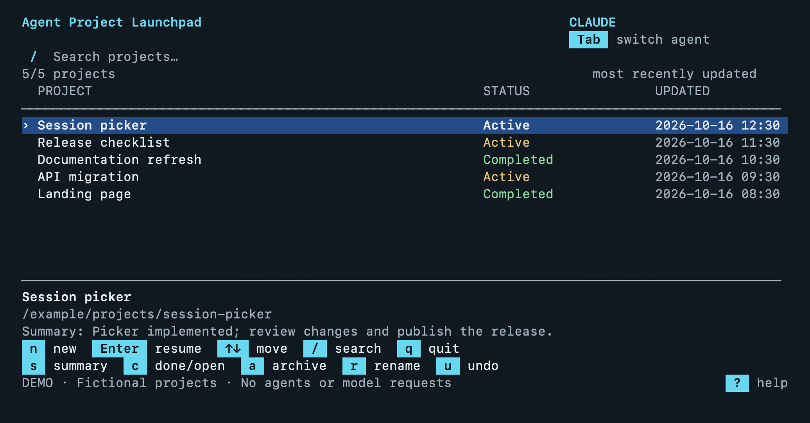

# Agent Project Launchpad

**Switch agents. Keep your place.**

Run `codex`, `claude`, or `gh copilot` as usual. Pick a project, see where it stands,
and continue with the agent you choose.

The launcher resumes native sessions and carries shared project notes and recent
conversation context between Codex, Claude Code, and GitHub Copilot CLI. You can
also ask an agent for a progress summary and a clearer project name.



*The actual picker renderer with fictional demo projects.*

## Install and enable

Requires macOS or Linux, Python 3.10+, and at least one agent already installed.

```sh
pipx install git+https://github.com/ssebro/agent-project-launchpad.git
agent-launchpad setup
```

**Open a new Terminal, then type your usual agent command. The picker should appear.**

`setup` is the core installation step: it adds startup integration for bash/zsh,
backs up the file it changes, and preserves the original agent commands.
Check the installation with `agent-launchpad check-shell`.

Need [pipx](https://pipx.pypa.io/) or prefer a virtual environment?
See the [installation guide](docs/guide.md#install).

## Try it

```sh
agent-launchpad demo
```

This runs the real picker with fictional projects. It launches no agents, makes
no model requests, and leaves your existing sessions alone.

## Everyday controls

| Key | Action |
| --- | --- |
| `↑` / `↓`, `Enter` | Select and continue a project |
| `Tab` | Switch agent |
| `n` | Start something new |
| `/` | Search |
| `s` | Generate a summary and suggested names; review before saving |
| `r` | Rename manually |
| `c` | Complete / reopen |
| `a`, `u` | Archive / undo archive |
| `?`, `Esc` | Help / cancel |

Projects start Active automatically. New conversation activity reopens completed
work. Archiving keeps the original history and can be undone.

## What carries over?

Each project has shared notes for decisions, progress, and next steps. Before
continuing, the launcher refreshes recent conversation excerpts and source
references for the selected agent to read. Full conversations stay in their
original agents. Context excerpts are bounded; important gaps still need review.

Data stays on your Mac or Linux machine until an agent reads it as model context.
Summaries use your existing agent account and normal usage. Nothing runs in the
background. [Details and privacy](SECURITY.md).

To remove startup integration, run `agent-launchpad uninstall-shell`.

[User guide](docs/guide.md) · [Troubleshooting](docs/compatibility.md) ·
[Contributing](CONTRIBUTING.md) · [Architecture](docs/architecture.md) · [MIT license](LICENSE)
